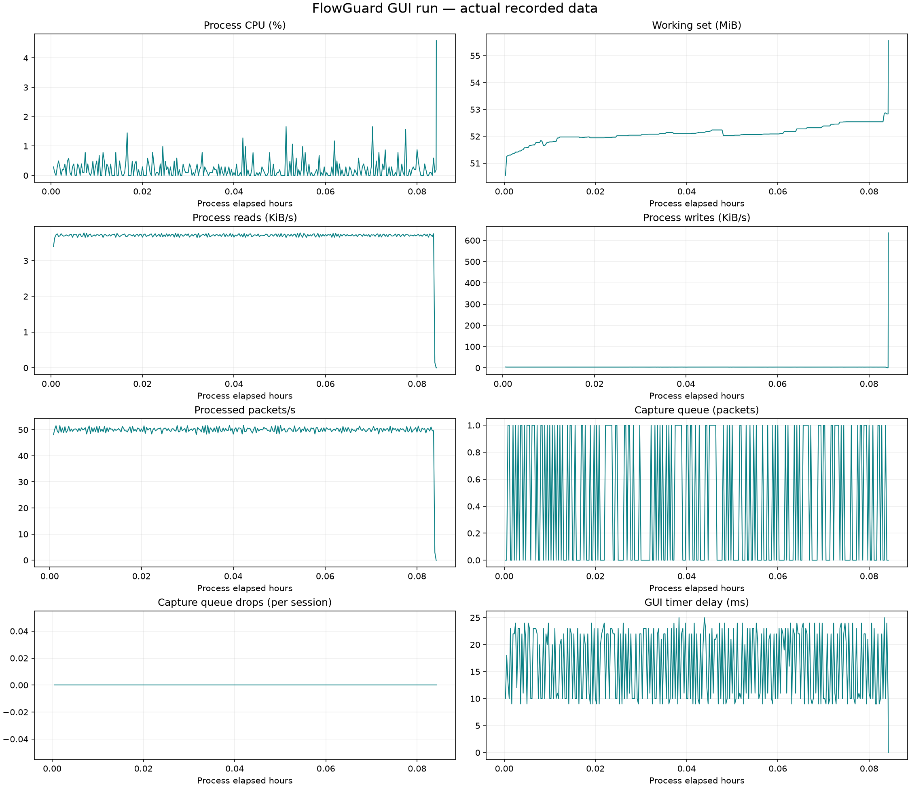

# FlowGuard 连续运行测试分析

本报告来自一个进程运行目录，不合并重启记录。自动汇总不代替人工验收。

| 指标 | 实测结果 |
| --- | --- |
| run_id | 20261122-024356-031-216a60fecbf74f56a6358d383174a190 |
| commit | b6d1aed4abcd8e5f5817b8f4e47bd78aeddd21ac |
| dirty_at_configure | true |
| started | 2026-11-21T18:43:56.031Z |
| ended | 2026-11-21T18:48:59.248Z |
| duration_seconds | 303.215 |
| observed_sample_span_seconds | 302.21299999999997 |
| normal_exit | True |
| logging_error |  |
| damaged_event_records | 0 |
| samples | 304 |
| missing_cpu_samples | 1 |
| missing_memory_samples | 0 |
| gaps_over_2_5_seconds | 0 |
| max_sampling_interval_seconds | 1.0149999999999864 |
| cpu_time_weighted_mean_percent | 0.2087678760612536 |
| cpu_peak_percent | 4.59408 |
| memory_start_bytes | 53002240.0 |
| memory_end_bytes | 58261504.0 |
| memory_peak_bytes | 58261504.0 |
| memory_change_bytes | 5259264.0 |
| memory_endpoint_growth_bytes_per_hour | 62649027.0107507 |
| max_queue_packets | 1.0 |
| max_gui_timer_delay_ms | 25.0 |
| process_read_bytes_delta | 1139848 |
| process_write_bytes_delta | 1242095 |
| duration_at_least_24h | False |
| manual_review_required | True |



## 分会话计数

```json
{
  "1": {
    "source": "1",
    "total_packets": 14998,
    "total_bytes": 839888,
    "saved_packets": 14998,
    "queue_dropped": 0,
    "display_dropped": 0,
    "late_history_packets": 0,
    "driver_dropped": 0,
    "interface_dropped": 0
  }
}
```

## 必须结合原始记录分析

- Duration is process lifetime; review session/source states to establish actual capture coverage.
- 24h duration alone is not a passing verdict. Inspect gaps, errors, responsiveness and normal computer use.
- Memory endpoint growth is descriptive, not proof of a memory leak.
- GUI timer delay is event-loop scheduling delay, not all user interactions latency.
- Process I/O is not physical disk throughput. First samples omit earlier process I/O.
- Per-session counters also use control-result snapshots; inspect event logs for very short sessions.

- CPU 是否随流量合理变化？
- 内存是否趋稳，还是持续增长？
- I/O、保存文件大小与保存策略是否一致？
- 队列是否积压，各类丢弃与错误有何原因？
- 人工操作是否响应，是否影响电脑正常工作？

请补充真实观察、异常与局限；不足 24 小时必须标为短时检查。
