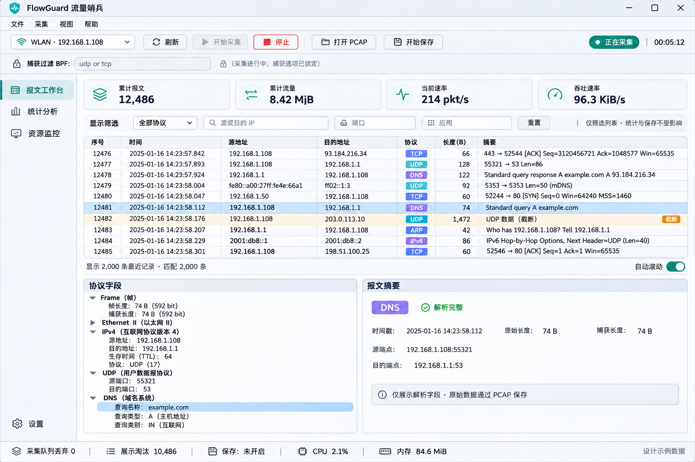
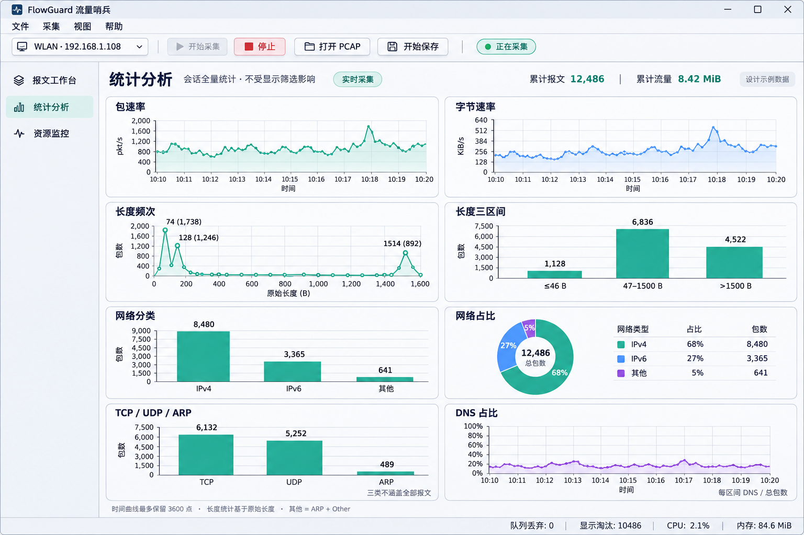
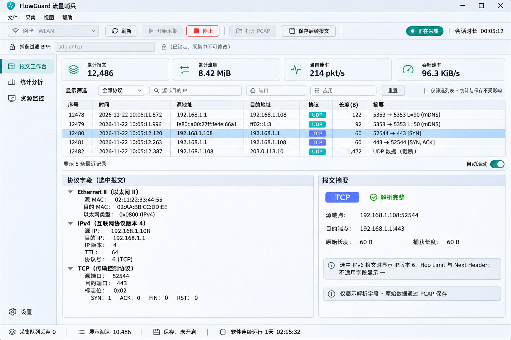
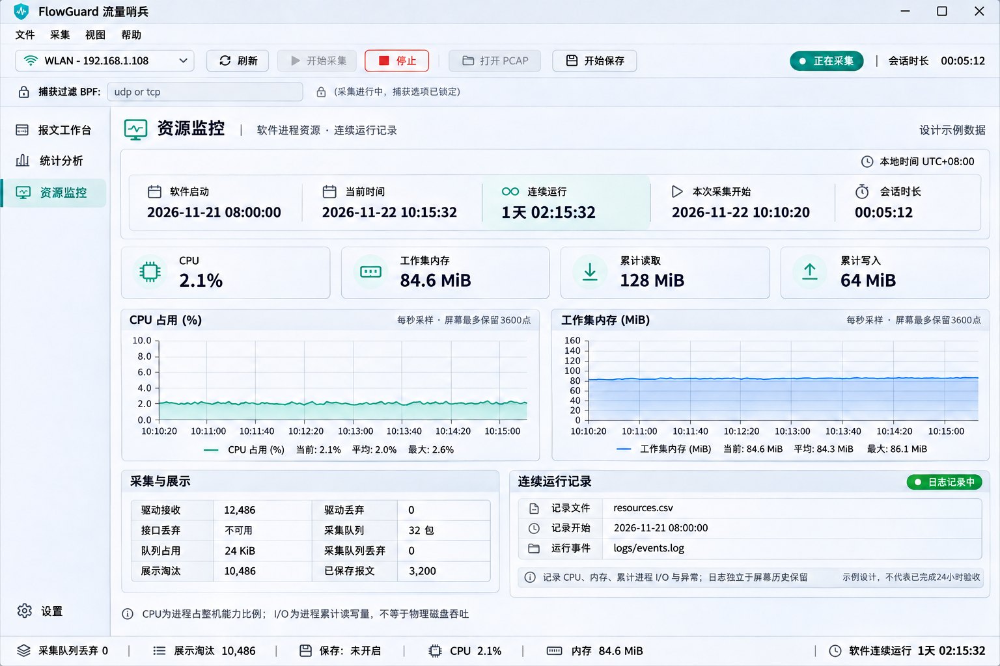
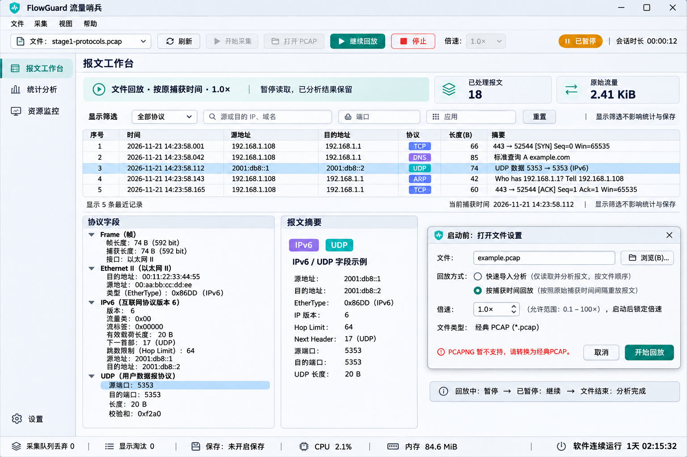

# 第三阶段：Qt 软件界面与交互设计（待验收）

设计日期：2026-11-22。基线：main `b6d1aed`。分支：`feat/stage3-qt-ui`。
这是视觉和交互提案，尚未实现 Qt 功能；图片中的数据均为示例。
任务书第三阶段对应历史 `stages.md` 表中的阶段 4。

后续实现更新：本设计已进入 Qt 实现，当前代码、测试与边界以 [第三阶段验收说明](stage3-acceptance.md) 为准。第 8、9、10 节保留早期设计验收的历史说明；第 7.1 节待办状态已按实现更新。
提交更新：用户已授权保存当前代码的本地 commit；早期“不自动提交”的说明是当时设计阶段的范围，当前仍未授权推送或合并。
最新界面反馈覆盖旧稿：网卡详情仅放悬停提示，主页面不重复来源/型号/IP 信息；恢复全窗口底栏，仅从左到右显示当前时间、本次采集开始、本次采集时长（文件模式对应文件处理）；顶部和资源页不重复时间。软件连续运行时长保留在日志而不显示。刷新按钮改名“刷新网卡”，采集中的主按钮和设置明确灰显；日志页面说明当前用户的自动存储位置，完整路径放提示中。列表文案区分会话累计、最近缓存和筛选结果。右下摘要不重复“源地址 → 目的地址”。旧设计图片和下文初始布局作为历史参考，当前行为以验收说明为准。
截取长度使用独立的上调、下调按钮，与数字输入区分开；空闲可调整，采集中锁定。资源监控保留原来的文字位置：采集计数在指标与图表之间，用对齐列和留白分隔；保存状态和曲线说明在图表下方。不折叠，不显示历史淘汰条数及底部日志状态、路径两行，保留整行打开目录按钮。指标含义用悬停提示解释。
材料复核纠正：老师及最终任务书要求软件连续运行一天并记录资源，没有限定校园网，也没有要求同一网络/网卡/采集会话必须无中断 24 小时。真实采集应尽量持续，网络切换及采集分段要如实记录；软件的连续运行证据仍由日志保留，不恢复已移除的冗余界面。具体切网检查见验收说明。

## 1. 产品形态与视觉

FlowGuard 流量哨兵是 Windows 桌面网络抓包与分析软件，采用 Qt Widgets，沿用标准菜单、工具栏、可拖动分隔面板和状态栏。
默认浅色：冷白背景、深蓝文字、青绿色主操作；错误用红色、异常用琥珀色，并配文字，不能仅靠颜色判断。
正文建议 10–11 pt，中文使用系统字体，地址和数值使用等宽字体；按字体与 DPI 自适应，不将整张设计图当背景。
参考窗口 1440×960，最小建议 1100×720，小窗口下工具栏换行、统计页滚动；面板用 QSplitter 调整。

软件图标方案：圆角深青底，白色盾牌外形融合网络流线，表达“流量 + 守护”；避免写入小号 FG 字母导致任务栏难辨。
生成图标是概念稿，确认后再整理透明 PNG、多尺寸 Windows ICO、Qt 资源与 Windows 可执行文件图标。

## 2. 窗口结构

| 区域 | 内容与用途 | Qt 建议 |
| --- | --- | --- |
| 菜单 | 文件（打开、回放、退出）、采集、视图、帮助 | QMenuBar / QAction |
| 控制区 | 网卡、刷新、开始、停止、打开 PCAP、保存开关；捕获设置单独一行 | QToolBar / QComboBox |
| 导航 | 报文工作台、统计分析、资源监控；切页不创建新会话 | QListWidget + QStackedWidget |
| 指标区 | 累计报文、原始流量、pkt/s、KiB/s；标明实时或捕获时间统计 | QLabel 组合 |
| 显示筛选 | 协议、源或目的 IP、源或目的端口、应用、重置 | 结构化控件 |
| 报文列表 | 序号、时间、源地址、目的地址、协议、原始长度、摘要；异常标记 | QTableView + QAbstractTableModel |
| 详情区 | 左侧协议字段树，右侧选中报文摘要、完整/截断/不支持/格式错误及 diagnostic | QTreeView + 摘要面板 |
| 状态栏 | 会话状态、队列丢弃、展示淘汰、保存状态、CPU、内存 | QStatusBar |

不设计十六进制查看：现有 ParsedPacket 不携带原始字节，也没有字段字节偏移。点击树节点展示完整键值，暂不承诺字节范围高亮。

## 3. 主要操作与状态

| 操作 | 用户动作与结果 | 限制/失败反馈 |
| --- | --- | --- |
| 选择网卡 | 显示说明和 IP，内部传递稳定 deviceId；刷新后优先保留原 ID | 没有网卡时显示空状态，开始禁用；失败提供重试 |
| 捕获设置 | 开始前编辑 BPF、混杂模式、截取长度等高级项 | 运行中锁定；BPF 错误显示后端原因，不显示为采集成功 |
| 开始采集 | 提交请求后显示“启动中”，成功才进入 Running 并初始化新会话视图 | 不允许重复开始；控制失败恢复可操作状态 |
| 停止 | 进入“正在停止”，后台排空实时队列、关闭保存，完成后保留结果 | 主线程不等待 join；停止完成前禁用重复控制 |
| 打开 PCAP | 空闲时选择经典 PCAP；默认快速导入，复用解析与统计 | PCAPNG 明确提示暂不支持；文件结束显示“分析完成” |
| 回放 | 打开文件对话框选择按时间回放及 0.1–100 倍速，启动后锁定倍速 | 当前后端不支持运行中变速/拖动定位，不提供进度百分比与跳转 |
| 暂停/继续 | 仅活动文件会话提供；暂停停止后续读取，继续保留结果 | 实时采集没有暂停按钮，避免误认为停止抓包 |
| 开始保存 | 选择新 .pcap 文件；显示“等待首包/准备保存”，确认 savingActive 后显示“保存中” | 保存从启用后的后续处理包开始，不是导出历史列表；不覆盖已有文件 |
| 结束保存 | 异步关闭并 flush，确认状态后显示“保存已结束” | 保存失败或达 1 GiB 上限显示持续提示，分析继续；累计已保存跨目标文件合计 |
| 切换来源/新会话 | 活动会话先停止；已有结果时说明新会话将重置视图与统计 | 失败前不主动清空旧结果；以实际 sessionId 识别新会话 |
| 关闭窗口 | 活动会话时确认结束，异步停止并确认文件关闭，再退出 | 已有关闭错误需明确提示，不能假称保存成功 |

Idle：允许配置、开始、打开文件。Running：允许停止、显示筛选与详情；仅 File 允许暂停。Paused：允许继续、停止与筛选。
Stopped / Completed：保留最后结果，允许新会话。Failed：保留已处理结果和错误原因，允许修改参数后重试。
界面另有短暂“启动中/正在停止”状态，属于控制请求状态，不伪造 ProcessingState 枚举。

## 4. 列表与筛选联动

- 单选报文同步字段树和摘要；新包不抢走选中行。记录淘汰时清空对应详情并说明已离开展示历史，避免悬空引用。
- 协议、IP、端口按 AND 组合；IP 匹配源或目的的规范化完整地址，端口匹配任一端口。DNS 为内容验证后识别，Other 指网络分类 Other。
- 点击“应用”才更新，非法 IP 或端口在输入处提示，保留上次有效筛选。重置只清筛选。
- 显示筛选仅重筛最近保留的 2000 条历史，不改变后端统计和 PCAP；界面同时显示保留数、匹配数和会话总数。
- 自动滚动开启时跟随新行；用户向上滚动时关闭，点击“回到最新”恢复。切页继续接收批次，防止 UI 缓冲无故堆积。
- 区分采集队列丢弃、驱动丢包与展示淘汰；驱动未提供计数时显示“不可用”，不得显示为 0。

## 5. 统计分析页

所有图表使用完整会话统计，不随显示筛选变化。页首显示数据源、统计区间和单位；可滚动的双列图表避免工作台塞入过多信息。

| 图表 | 数据与交互 |
| --- | --- |
| 包速率/字节速率时间曲线 | pkt/s 与 KiB/s 分图或切换，避免混用同一纵轴；悬停查看时间和值 |
| 长度频次折线（必做） | X=原始长度 B，Y=包数，按长度排序；溢出键 65536 标为 >65535 |
| 长度三区间柱状（必做） | ≤46 B、47–1500 B、>1500 B；边界不得按 Ethernet 最小帧常识自行修改 |
| 网络分类柱状（必做） | IPv4、IPv6、其他；其他=ARP+Other |
| 网络分类饼图 | IPv4、IPv6、其他，显示包数和占比；无包时显示空态 |
| TCP/UDP/ARP 柱状 | TCP/UDP 取传输分类，ARP 取网络分类，不声称三项覆盖所有包 |
| DNS 占比时间曲线 | 每采样区间 DNS 包数/全部包数×100%，Y=0–100%；无包区间为 0 |

实时速率采用实际采样间隔；离线曲线按原捕获时间分桶，绝不把导入速度当网络速率。
历史只显示最多最近 3600 个时间点；lateHistoryPackets 非零时说明过旧乱序包只进入累计统计。
初版悬停查看数值，图表点击不自动改变显示筛选；避免产生统计口径随点击变化的误解。

## 6. 资源与错误反馈

资源页每秒采样：进程 CPU（占整机总逻辑 CPU 能力）、工作集内存、累计进程读写字节。I/O 不是 PCAP 文件大小，也不是物理磁盘吞吐。
资源页上方放 CPU、工作集、累计读取、累计写入四项指标，下方放 CPU 与内存时间曲线，再列出驱动接收/丢弃、采集队列深度、队列字节、展示淘汰和保存包数。资源页切换不暂停采集，不提供“清零”去篡改会话指标。
资源页必须增加“软件启动时间、当前时间、连续运行时长、当前会话开始时间、会话时长”。连续运行时长使用单调时钟计算，不能在停止采集或新建会话时清零；日期时间包含日期及本地时区。状态栏常驻连续运行时长，工具栏显示会话时长并明确名称。
首次 CPU 或采样失败显示不可用；资源采样函数已在第三阶段实现。
长测日志与屏幕曲线分开，日志失败持续提示；24 小时验收尚未完成。
资源日志设计采用 `resources.csv` 记录采样，事件日志记录来源错误、保存失败、会话切换和退出等事件。默认启用持续资源记录，创建日志失败时显示明确错误，不能仍显示“记录中”。记录状态以实际文件成功打开和后续写入结果为准。日期、时长及日志均标注软件进程与会话的区别；长测过程中重启程序不能拼接为一次连续运行。
来源致命错误进入 Failed；保存失败保持分析并显示保存错误；一般输入错误内联显示。没有后端能力的安全告警不放入本版。

## 7. Qt 接入顺序（设计确认后实施）

1. 窗口骨架、统一动作状态、图标资源和可缩放布局。
2. 单一控制线程串行调用 ProcessingSession 的控制方法；GUI QTimer 每 100 ms 读取快照及最多 500 条报文。
3. 有界列表、字段树、sessionId 隔离和显示筛选；开始/打开/停止及保存关闭不得阻塞 GUI。
4. 接入全部统计图，再实现 Windows 资源采样与错误展示；Qt Charts 是新增依赖，需通过 CMake 验证。
5. 标准 CMake 构建、CTest 回归、固定 PCAP 对照和人工操作验收；测试通过后再决定长测范围。

### 7.1 连续运行证据与性能分析待实现清单

以下是正式实现/验收任务，不仅是资源页面的展示建议。已实现能力标记如下；标记表示代码与自查，不表示用户或老师验收。长测执行需在完整程序验收和用户确认后开展。

**第三阶段内实现：采集与记录能力**

- [x] 实现软件启动日期时间、当前时间、基于单调时钟的连续运行时长，以及独立的会话起始时间和时长；切换会话不重置软件连续运行时长。
- [x] 实现 Windows 进程资源采样：CPU、工作集内存、累计进程读写字节；每秒采样，首次无区间或采样失败明确记录为不可用。
- [x] 持续写资源 CSV：记录时间戳、独立进程运行目录、会话 ID、实际经过秒数、资源数据；独立于界面的 3600 点上限，保留完整测试时段。
- [x] 同步记录处理包数/字节数、保存包数、采集队列深度/字节、队列丢弃、可用的驱动/接口丢弃及展示淘汰；各指标含义分开。
- [x] 实现事件日志：启动、控制请求/结果、会话状态、来源异常、保存失败及正常退出；写入/flush 错误在界面和退出结果中提示（写盘失败时不能保证事件日志自身仍可写）。
- [x] 记录运行清单：配置时 commit/dirty、版本、EXE 哈希、操作系统、CPU/内存配置、网卡及采集/保存设置、日志格式版本；不记录凭据。
- [x] 完成测试收尾记录：开始/结束日期时间、实际连续运行秒数、正常退出、最终计数和异常摘要；分析工具只读取一次运行，异常终止不能拼接为一天。
- [ ] 验证正常记录、无权限/磁盘不足等写入失败、跨天计时、会话切换、暂停、退出和有界缓存；在正式长测前用短时记录验证数据可用于后续分析。

**正式长测前准备，测试后交付：分析与验收材料**

- [x] 建立人工操作记录表 `docs/long-run-observations.csv`；定时器延迟独立采样，明确不等同所有交互响应时间。真实观察记录待用户实施。
- [x] 实现 `tools/analyze_run.py`，从完整日志输出 CPU、内存、I/O、包速率、队列/队列丢弃、GUI 定时器延迟曲线，缺失样本与采样缺口不伪造零值。
- [x] 实现汇总：实际时长、缺失数、加权 CPU 平均/峰值、内存首尾/峰值/变化、I/O 增量、分会话计数及错误；真实全天汇总待正式测试。
- [x] 制定正式连续至少 24 小时的步骤与异常判定，见 `stage3-acceptance.md`；固定版本、核对保存策略和磁盘容量。
- [ ] 在用户确认后运行完整 Qt 软件至少 24 小时，保留原始日志、开始/结束及关键时刻截图、人工使用记录；记录中断与错误，不用命令行后端测试替代 GUI 长测。
- [ ] 编写性能与稳定性分析：解释 CPU 与流量关系、内存是否持续增长或趋稳、I/O 与文件开销、队列积压/丢弃、界面响应及对正常工作的影响；结论以记录为依据，不编造资源合格阈值。
- [ ] 整理 DOC 中的测试环境、方法、结果图表、汇总表、异常说明、局限和结论，并保留原始证据便于复核；报告中的全天图由日志生成，不截取最近一小时代替。

短时开发检查与最终全天测试分别留证。队友已有的 300 秒后台测试仅作参考，不勾选上述 Qt 长测与最终分析任务。

控制对象活到所有读者停止后才销毁；退出时先停止定时器，完成控制队列和后台 stop，再释放对象。
UI 列表上限 2000，后端展示缓冲上限 2000，单批上限 500，曲线最多 3600 点；这些是不同层次的边界。

## 8. 本次验收

本次只完成同步基线、建立分支、视觉稿和交互规范，不声称 Qt 功能已接入，也没有重新执行队友的构建与 300 秒测试。
请检查主工作台布局、图标方向、中文密度、各按钮状态和统计页内容。设计确认后才开始 Qt 实现；本次不自动提交、推送或合并。

图像和生成提示词见同目录 `design/`。图片可能存在生成文字误差，精确行为以本规范及后端接口为准。
主工作台概念图在采集中仍将“打开 PCAP”画为普通按钮，实际实现必须按本规范禁用来源切换，或先走停止流程；不能直接并行启动文件分析。

## 9. 老师原始要求复核（2026-11-22）

依据外层课程资料中的《老师要求.png》和《网络流量检测课程设计任务书_最终整合版.docx》直接核对，不能只以仓库阶段总结代替原文。

| 要求 | 当前设计覆盖 | 纠正/后续验收 |
| --- | --- | --- |
| 简洁 GUI、捕获本机报文 | 工作台含网卡及开始/停止控制 | 需真实 Qt 操作验证 |
| 链路层关键字段 | 有 Ethernet 树容器，图片节点折叠，未逐项画出 | 明确必须展示源 MAC、目的 MAC、以太网类型 |
| 网络层关键字段 | 图中展示 IP、TTL、协议，字段清单不完整 | 明确必须展示源/目的 IP、IP 版本、IPv4 TTL 或 IPv6 Hop Limit、协议号/Next Header；不适用字段标注不可用 |
| 传输层关键字段 | 图中只演示 UDP，没有 TCP flags 展开示例 | TCP/UDP 源/目的端口；TCP SYN/ACK/FIN/RST 逐项展示值，不能只显示一串原始掩码 |
| 长度频次折线、三区间柱状 | 统计设计图已包含 | 保留 ≤46、47–1500、>1500 的无重叠整数边界 |
| IPv4/IPv6/其他数量柱状 | 统计设计图已包含 | 数量与会话统计对照 |
| 原始数据保存及自行读取展示 | 工作台保存/打开入口，规范含回放 | 回放设置、暂停/继续状态尚缺视觉稿；保存入口明确命名“保存后续原始报文”，不暗示导出全部历史 |
| 运行一天以上，输出运行时间与时长 | 第一版只画了无名称时长，覆盖不足 | 按第 6 节补充软件启动时间、当前时间与连续运行时长；会话时长单独显示 |
| 观察并记录资源消耗、分析且不影响正常使用 | 资源页有文字规格，无独立视觉稿 | 需补资源页画面、持续资源日志、长测与分析；CPU/内存/累计进程读写量和 GUI 响应均需实际证据 |
| 最终任务书追加饼图、TCP/UDP/ARP 柱状、DNS 占比曲线 | 统计设计图已包含 | 不能以长度图代替这三项 |
| ARP/DNS 字段、显示过滤、速率与批量刷新 | 设计/规范已覆盖 | 仍需实现与验证，不等同于视觉稿验收 |
| SYN 泛洪等异常检测报警 | 没有设计 | 老师截图将其列为可选扩展，不是必做遗漏 |

第一版视觉稿不是完整验收稿：当时尚缺资源页、回放状态、完整字段展开示例与明确时间信息。本轮补图见第 10 节。
24 小时连续运行、资源记录及分析属于程序和交付验收，不能靠页面上的示例数值证明完成；队友 300 秒测试不替代它们。

## 10. 补充设计图与交互对应

本轮保留浅色、青绿色和原窗口结构，补充以下设计稿；旧版仅作为设计历史保留。

| 设计稿 | 对应检查点 |
| --- | --- |
| 工作台 v2 | Ethernet 源/目的 MAC、以太网类型；IPv4 源/目的地址、版本、TTL、协议号；TCP 源/目的端口与 SYN/ACK/FIN/RST；运行中禁用直接打开文件；时长标签区分 |
| 资源监控 v1 | 软件启动与当前日期时间、跨天连续运行时长、本次采集开始时间与会话时长；CPU、内存、I/O、日志状态和丢弃分类 |
| 文件回放 v1 | 启动前模式与倍速设置；文件来源专用暂停/继续/停止；IPv6 Hop Limit/Next Header 和 UDP 端口展示；不支持 PCAPNG 的提示 |

回放设置小窗表示“启动前”的独立示例，不是在暂停会话中允许并行打开另一个文件。回放的会话时长是实际墙钟经过时间（单调时钟），包含暂停；不等同于报文的捕获时间或回放推进量。
软件连续运行时长在所有页面状态栏常驻，新建或停止会话不清零。资源页给出完整日期时间，标题栏和工具栏不必挤入所有时间字段。
静态图中的资源记录只是界面状态示例，日志记录、资源采样及日期计时仍待真实 Qt 接入。
回放图的 IP 输入提示误带“域名”，实现时仅写“源或目的 IP”；当前 DisplayFilter 不提供域名筛选。回放设置的 PCAPNG 错误文案仅用于失败状态示例，实际选中合法 PCAP 时不显示该错误。

